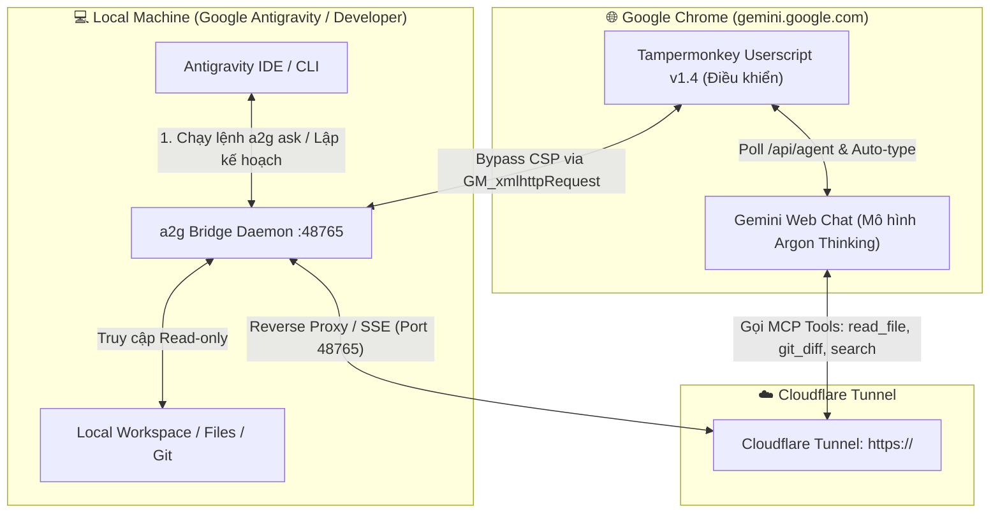

# Anti with Gehihi (`a2g`)

> **"Gemini Web thinks. Antigravity works."**  
> Cầu nối tự động hoá hai chiều hoàn chỉnh giữa **Google Gemini Web** và **Google Antigravity** thông qua MCP (Model Context Protocol), Cloudflare Tunnel và Tampermonkey Userscript.

[](https://github.com/lecuong2512/anti-with-gehihi)
[](https://opensource.org/licenses/MIT)
[](https://nodejs.org/)
[]()

---

## 📑 Mục lục hướng dẫn
1. [🌟 Tổng quan kiến trúc & Phân công vai trò](#-tổng-quan-kiến-trúc--phân-công-vai-trò)
2. [⚡ Cài đặt nhanh trong 3 phút (Quickstart)](#-cài-đặt-nhanh-trong-3-phút-quickstart)
3. [🔌 Hướng dẫn chi tiết: Cấu hình URL MCP trên Gemini Web](#-hướng-dẫn-chi-tiết-cấu-hình-url-mcp-trên-gemini-web)
4. [🧩 Hướng dẫn chi tiết: Cài đặt & Vận hành Extension Chrome điều khiển](#-hướng-dẫn-chi-tiết-cài-đặt--vận-hành-extension-chrome-điều-khiển)
5. [🚀 Trải nghiệm tự động hoá 2 chiều (`a2g ask`)](#-trải-nghiệm-tự-động-hoá-2-chiều-a2g-ask)
6. [📖 Bảng tra cứu lệnh CLI (`a2g`)](#-bảng-tra-cứu-lệnh-cli-a2g)
7. [🛡️ Cơ chế bảo mật & Kỹ thuật cốt lõi](#-cơ-chế-bảo-mật--kỹ-thuật-cốt-lõi)
8. [❓ Xử lý sự cố thường gặp (Troubleshooting)](#-xử-lý-sự-cố-thường-gặp-troubleshooting)

---

## 🌟 Tổng quan kiến trúc & Phân công vai trò



### Phân công vai trò

| Thành phần | Vai trò | Trách nhiệm cụ thể |
| :--- | :--- | :--- |
| **Google Gemini Web** | **Bộ Não (Chief Architect)** | Phân tích bài toán kiến trúc, đọc hiểu toàn bộ codebase qua công cụ MCP (Read-only), lập kế hoạch thực hiện từng bước (Implementation Plan) và review code. |
| **Google Antigravity** | **Cánh Tay (Lead Engineer)** | Trực tiếp tạo/sửa code, chạy terminal, cài thư viện, debug, biên dịch, chạy unit test và quản lý commit Git. |
| **A2G Bridge Server** | **Cầu Nối (Bridge Daemon)** | Cung cấp MCP server đạt chuẩn OAuth2 + SSE, quản lý hàng đợi tác vụ tự động `/api/agent`, cung cấp CLI `a2g` điều khiển daemon. |
| **Tampermonkey Userscript** | **Người Đưa Thư & Điều Khiển** | Tự động hóa trình duyệt Chrome: bắt câu hỏi từ Bridge, tự động gõ vào ô chat Gemini, theo dõi trạng thái suy nghĩ, bắt chính xác lúc hoàn tất qua nút Copy, và gửi kết quả ngược về Bridge. |

---

## ⚡ Cài đặt nhanh trong 3 phút (Quickstart)

### Bước 1: Clone mã nguồn & Cài đặt
Yêu cầu Node.js >= 20 và `pnpm` (hoặc `npm`).

```bash
git clone https://github.com/lecuong2512/anti-with-gehihi.git
cd anti-with-gehihi
pnpm install
pnpm build
npm link
```
*Lệnh `npm link` giúp bạn có thể gõ trực tiếp lệnh `a2g` ở bất kỳ thư mục nào trên máy tính.*

### Bước 2: Khởi chạy Bridge Daemon
```bash
# Windows PowerShell:
.\scripts\start-bridge.ps1

# Linux / macOS:
./scripts/start-bridge.sh

# Hoặc dùng CLI trực tiếp cho thư mục hiện tại:
a2g setup -w .
```

Bridge sẽ tạo một mã **Pairing Code** gồm 6 ký tự (ví dụ: `849201`) có hiệu lực trong 5 phút để bạn kết nối lần đầu với Gemini Web.

---

## 🔌 Hướng dẫn chi tiết: Cấu hình URL MCP trên Gemini Web

> [!IMPORTANT]
> **Đoạn chat phải thuộc Nhiệm vụ (Task / Workspace) có bật MCP Tools**, không dùng cuộc trò chuyện thông thường vì Gemini chỉ kích hoạt khả năng gọi công cụ MCP trong không gian nhiệm vụ.

### 1. URL MCP Server là gì?
- **URL máy chủ MCP:** `https://<your-tunnel-domain>/mcp` *(kết thúc bằng `/mcp`)*
- Hoặc nếu chạy nội bộ: `http://127.0.0.1:48765/mcp`
- Bản chất: Đây là endpoint chuẩn **Model Context Protocol** qua giao thức HTTP SSE + POST, được bảo vệ bằng cơ chế OAuth 2.0 PKCE và mã ghép đôi Pairing Code.

### 2. Các bước cấu hình từng bước trên Gemini Web:

1. Mở trình duyệt Chrome và truy cập [gemini.google.com](https://gemini.google.com).
2. Vào đoạn chat thuộc **Nhiệm vụ (Task)** của bạn.
3. Bấm vào biểu tượng **Công cụ (Tools / MCP Server)** hoặc dấu `+` để thêm công cụ mới.
4. Chọn **Thêm máy chủ MCP (Add MCP Server)**:
   - **Tên máy chủ (Server Name):** `Antigravity Bridge` (tuỳ chọn)
   - **URL máy chủ (Server URL):** `https://<your-tunnel-domain>/mcp`
   - **Client ID (Mã ứng dụng):** **BỎ TRỐNG (Leave empty)**
   - **Client Secret (Khoá bí mật):** **BỎ TRỐNG (Leave empty)**
5. Nhấn nút **Kết nối (Connect)** hoặc **Xác thực (Authenticate)**.
6. Trình duyệt sẽ mở một tab mới chuyển hướng đến màn hình xác thực: `Authorize Antigravity Bridge`.
7. **Lấy Pairing Code:** Quay lại Terminal của Antigravity, gõ lệnh:
   ```powershell
   a2g pair
   ```
   Hệ thống sẽ in ra mã gồm 6 chữ số ngẫu nhiên (ví dụ: `849201`).
8. Dán mã 6 số này vào ô xác thực trên trình duyệt và nhấn **Ủy quyền (Authorize)**.
9. Tab xác thực đóng lại, Gemini Web báo **Đã kết nối thành công**.

### 3. Các công cụ MCP Gemini Web sẽ được cấp quyền (Read-Only):
Gemini Web sẽ tự động nhìn thấy và gọi được 6 công cụ an toàn sau để phục vụ phân tích:
- `read_file`: Đọc nội dung file cụ thể trong dự án.
- `list_directory`: Duyệt cây thư mục và file.
- `search_files`: Tìm kiếm file theo tên hoặc regex.
- `git_status`: Xem trạng thái các file đang sửa đổi.
- `git_diff`: Xem nội dung thay đổi chi tiết giữa các commit hoặc working tree.
- `get_workspace_info`: Xem tên thư mục, đường dẫn và ID của workspace hiện tại.

> [!TIP]
> **Đổi dự án làm việc không cần kết nối lại:** Khi bạn chuyển sang làm việc ở thư mục dự án khác, chỉ cần chạy lệnh:
> ```powershell
> a2g workspace "D:\Duong\Dan\Den\DuAnMoi"
> ```
> Gemini Web sẽ lập tức đọc codebase của dự án mới mà không cần cấp quyền lại!

---

## 🧩 Hướng dẫn chi tiết: Cài đặt & Vận hành Extension Chrome điều khiển

Extension điều khiển được xây dựng dưới dạng **Tampermonkey Userscript** để có toàn quyền điều khiển DOM của Gemini Web và vượt qua rào cản CSP của Google.

### Bước 1: Cài đặt tiện ích Tampermonkey trên Chrome
1. Mở Chrome và truy cập: [Tampermonkey trên Chrome Web Store](https://chromewebstore.google.com/detail/tampermonkey/dhdgffkkebhmkfjojejmpbldmpobfkfo).
2. Nhấn **Thêm vào Chrome (Add to Chrome)**.

### Bước 2: BẬT Chế độ nhà phát triển (Developer Mode) trên Chrome
> [!WARNING]
> **BƯỚC BẮT BUỘC TRÊN CHROME HIỆN ĐẠI (Manifest V3):** Nếu không bật Developer Mode, Chrome sẽ chặn Tampermonkey chạy UserScripts can thiệp vào trang web.

1. Trên thanh địa chỉ Chrome, nhập: `chrome://extensions/` và nhấn Enter.
2. Tìm công tắc **Chế độ dành cho nhà phát triển (Developer mode)** ở góc trên cùng bên phải và **BẬT (ON)** nó lên.

### Bước 3: Cài đặt Script điều khiển vào Tampermonkey
1. Bấm vào biểu tượng Tampermonkey trên thanh công cụ Chrome -> Chọn **Dashboard (Bảng điều khiển)**.
2. Chọn tab **Tiện ích (Utilities)**.
3. Trong phần **Cài đặt từ tệp (Install from file)**, nhấn **Choose File** và chọn file:
   `userscript/gemini-antigravity-bridge.user.js` (hoặc file `d:\Nghich\MCP\anti-with-gehihi\userscript\gemini-antigravity-bridge.user.js`).
4. Tampermonkey sẽ mở tab cài đặt -> Nhấn **Cài đặt (Install)**.

### Bước 4: Kiểm tra và làm quen với Widget điều khiển trên Gemini Web
1. Truy cập [gemini.google.com](https://gemini.google.com).
2. Bạn sẽ thấy một **widget hình con nhộng nổi** ở góc dưới cùng bên phải màn hình:

| Màu sắc & Trạng thái | Ý nghĩa hoạt động |
| :--- | :--- |
| 🟢 **`Gehihi: Sẵn sàng (Idle)`** | Script đang lắng nghe hàng đợi, sẵn sàng nhận lệnh từ Antigravity. |
| 🟡 **`Gehihi: Đang nạp câu hỏi...`** | Đã nhận prompt, đang tự động focus ô chat `rich-textarea` và dán văn bản. |
| 🟡 **`Gehihi: Gemini đang nhận lệnh...`** | Đã kích hoạt sự kiện gửi phím Enter / nút Send. |
| 🟣 **`Gehihi: Đang suy nghĩ (Xs)...`** | Gemini (Argon Thinking) đang tư duy và gọi các công cụ MCP qua tunnel. |
| 🔵 **`Gehihi: Đang sinh câu trả lời (Xs)...`** | Gemini đang xuất văn bản trả lời ra màn hình. |
| 🟡 **`Gehihi: Đang gửi kết quả về...`** | Đã bắt trọn vẹn câu trả lời sạch, đang gửi về Bridge API. |
| 🔴 **`Gehihi: Lỗi...`** | Không tìm thấy ô nhập liệu hoặc mất kết nối mạng đến Bridge. |

> [!TIP]
> **Tính năng đổi URL Bridge cực nhanh:**
> Click chuột trực tiếp vào widget hình con nhộng ở góc phải màn hình. Một hộp thoại sẽ hiện ra cho phép bạn đổi địa chỉ Bridge (ví dụ: chuyển giữa `https://<your-tunnel-domain>` và `http://127.0.0.1:48765`). Giá trị này sẽ được lưu cố định vào `localStorage`.

### 5. Cơ chế điều khiển thông minh của Extension:
- **Vượt rào cản CSP 100%:** Do Google Gemini áp dụng chính sách Content Security Policy (Trusted Types) rất chặt chẽ, lệnh `fetch()` thông thường ra ngoài sẽ bị chặn. Userscript sử dụng `GM_xmlhttpRequest` chạy ngầm trong context đặc quyền của tiện ích mở rộng để liên lạc với Bridge.
- **Không bao giờ bị cắt ngắn câu trả lời (Accurate Turn Completion):** Khi dùng mô hình có tư duy (Thinking), Gemini sẽ hiển thị trạng thái `"Đang suy nghĩ..."` từ 20 đến 60 giây và có thể dừng ngắt quãng để gọi MCP. Extension **không dùng bộ đếm thời gian tĩnh**, mà **bắt buộc kiểm tra sự xuất hiện của nút Copy (`button[aria-label*="Sao chép"]`)** ở cuối thẻ `<model-response>` và xác nhận không còn chữ "Đang suy nghĩ" thì mới trích xuất câu trả lời.
- **Trích xuất nội dung sạch:** Tự động lọc bỏ các khối tư duy xổ xuống (collapsible thinking process) và các nút bấm giao diện, chỉ lấy văn bản câu trả lời thuần túy trong thẻ `<message-content>`.

---

## 🚀 Trải nghiệm tự động hoá 2 chiều (`a2g ask`)

Sau khi cài đặt xong cả URL MCP và Chrome Extension, bạn có thể để Antigravity tự động giao tiếp với Gemini Web hoàn toàn rảnh tay!

```powershell
# Gửi câu hỏi yêu cầu Gemini Web thiết kế kiến trúc:
a2g ask "Hãy đọc cấu trúc codebase hiện tại và cho tôi kế hoạch chi tiết để tối ưu hóa hiệu năng ứng dụng"
```

Hoặc dùng script PowerShell:
```powershell
.\scripts\ask-gemini.ps1 "Kiểm tra xem file package.json và src/index.ts có vấn đề gì không?"
```

**Toàn bộ vòng lặp diễn ra như sau:**
1. Lệnh `a2g ask` đẩy prompt vào hàng đợi `/api/agent/enqueue`.
2. Extension trên Chrome phát hiện prompt mới -> tự động dán vào khung chat Gemini Web và nhấn Gửi.
3. Gemini Web tư duy, tự động gọi các công cụ MCP `read_file`, `git_diff`... qua Cloudflare Tunnel để đọc code trực tiếp trên máy bạn.
4. Khi Gemini Web sinh xong câu trả lời hoàn chỉnh (nút Sao chép xuất hiện), Extension trích xuất nội dung và gửi trả về Bridge API `/api/agent/response`.
5. Terminal Antigravity nhận được nội dung câu trả lời lập tức và tiếp tục thực hiện code theo kế hoạch!

---

## 📖 Bảng tra cứu lệnh CLI (`a2g`)

| Lệnh | Mô tả chi tiết |
| :--- | :--- |
| `a2g status` | Kiểm tra tình trạng hoạt động của Bridge daemon, cổng kết nối, trạng thái tunnel và quyền OAuth. |
| `a2g setup -w <path>` | Khởi động bridge và cấp Pairing Code cho thư mục chỉ định. |
| `a2g pair` | Tạo mã Pairing Code mới gồm 6 số (hiệu lực 5 phút) để cấp quyền kết nối MCP. |
| `a2g unpair` | Thu hồi ngay lập tức toàn bộ access token kết nối vào workspace. |
| `a2g workspace <path>` | **Chuyển workspace tức thì:** Thay đổi thư mục dự án mà Gemini đang kết nối mà không cần cấu hình lại MCP! |
| `a2g ask "<prompt>"` | Gửi câu hỏi sang Gemini Web qua Userscript và chờ kết quả trả về (timeout mặc định 600s). |
| `a2g stop` | Dừng daemon chạy ngầm. |
| `a2g restart` | Khởi động lại daemon chạy ngầm. |
| `a2g doctor` | Chẩn đoán toàn diện hệ thống mạng, loopback, tunnel, token và quyền thư mục. |
| `a2g logs` | Xem log hoạt động gần nhất của bridge daemon. |

---

## 🛡️ Cơ chế bảo mật & Kỹ thuật cốt lõi

- **An toàn tuyệt đối (Read-Only by Design):** Toàn bộ các công cụ MCP mà Gemini Web có quyền gọi (`read_file`, `list_directory`, `search_files`, `git_status`, `git_diff`) đều là **CHỈ ĐỌC (Read-Only)**. Gemini Web hoàn toàn không thể xóa file, sửa code hay chạy lệnh shell trên máy tính của bạn.
- **Xác thực 2 lớp (Pairing Code + OAuth2 Bearer Token):** Chỉ người dùng ngồi trực tiếp trước máy tính và chạy lệnh `a2g pair` mới có thể sinh mã xác thực cấp phép. Token được ký ngẫu nhiên và lưu an toàn trong thư mục cấu hình cục bộ.
- **Bảo vệ mạng nội bộ:** Cổng 48765 chỉ lắng nghe trên giao diện loopback cục bộ (`127.0.0.1`). Mọi kết nối từ bên ngoài bắt buộc phải đi qua Cloudflare Tunnel có mã hóa TLS và xác thực OAuth.

---

## ❓ Xử lý sự cố thường gặp (Troubleshooting)

### Q1: Bị lỗi `EADDRINUSE: address already in use 127.0.0.1:48765`
- **Nguyên nhân:** Đã có một tiến trình bridge đang chạy ngầm chiếm cổng 48765.
- **Khắc phục:** Chạy lệnh `a2g stop` hoặc tắt tiến trình Node.js cũ:
  ```powershell
  Get-Process -Name node | Where-Object { $_.CommandLine -like "*a2g*" } | Stop-Process
  ```

### Q2: Gemini Web báo "Không thể kết nối với máy chủ MCP"
- **Kiểm tra 1:** Kiểm tra bridge đang chạy hay không bằng lệnh `a2g status`.
- **Kiểm tra 2:** Kiểm tra tunnel có thông mạng không:
  Mở trình duyệt truy cập `https://<your-tunnel-domain>/health`, nếu trả về `{"service":"a2g-bridge","status":"ok"}` là mạng hoàn toàn bình thường.
- **Kiểm tra 3:** Đảm bảo khi thêm MCP server trên Gemini, các ô **Client ID** và **Client Secret** được **bỏ trống**.

### Q3: Userscript không hiển thị widget màu xanh trên Gemini Web
- **Kiểm tra 1:** Đảm bảo bạn đã **BẬT Developer Mode** trong `chrome://extensions/`.
- **Kiểm tra 2:** Bấm vào icon Tampermonkey trên thanh tiện ích, đảm bảo công tắc của script `Antigravity <-> Gemini Web Bridge` đang ở trạng thái **BẬT (Enabled)**.
- **Kiểm tra 3:** Tải lại trang `https://gemini.google.com` (nhấn F5 hoặc Ctrl+F5).

### Q4: Lệnh `a2g ask` bị timeout sau 600s
- Đối với những yêu cầu phân tích kiến trúc cực kỳ phức tạp hoặc codebase rất lớn, Gemini Web có thể mất nhiều thời gian hơn. Bạn có thể tăng thời gian timeout bằng cờ `-t`:
  ```powershell
  a2g ask "Phân tích toàn bộ hệ thống" -t 1200
  ```

---

## 📄 Bản quyền (License)

Phát hành dưới giấy phép mã nguồn mở **MIT License**.
Được xây dựng với tinh thần kết hợp sức mạnh tối đa giữa **Google Gemini Web** và **Google Antigravity**.
